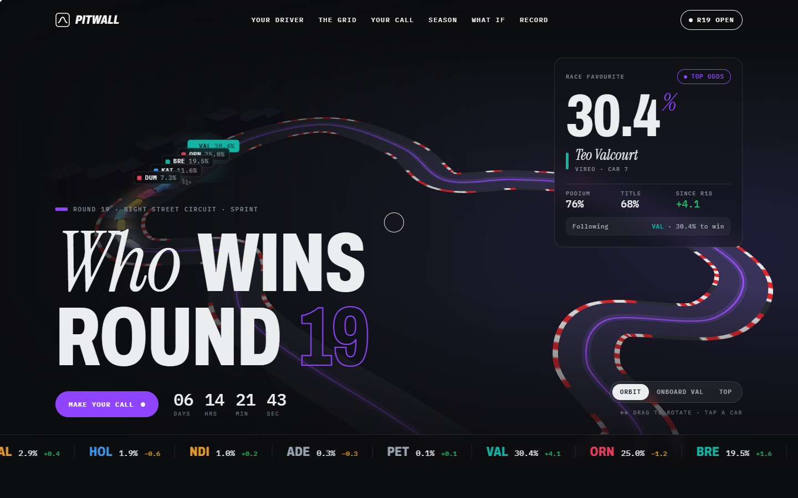

# PitWall

**Who wins the next Grand Prix, and who takes the title?**

PitWall is an AI/ML Formula 1 forecaster. It predicts win odds for every driver at every race of the 2027 season, simulates the championship 10,000 times, publishes each forecast before the race and scores itself in public afterwards.

> Status: in development. Phases 1 (setup) and 2 (data) are done. The interactive design prototype is in [`prototype/`](prototype/). Open `prototype/index.html` in a browser.



## What makes it different

- **Predictions on the record.** Every forecast is timestamped before lights out and scored afterwards with a Brier score, next to two simple baselines: back the favourite, and pole sitter wins.
- **The whole season, up front.** The 2027 forecast is published before round 1, then updated after every weekend.
- **An honest backtest.** Seasons 2019–2026 are each predicted using only the data available before that season.
- **What-if simulator.** Force a retirement, add rain or drop sprint points, then re-run 10,000 seasons in the browser.
- **Explained odds.** Each prediction shows which factors moved it.
- **A broadcast-grade interface.** A 3D night race with TV-style camera cuts, live timing, an onboard dashboard and a studio car showcase.

## How it works

| Layer | Tools |
|---|---|
| Data | Jolpica API (results, qualifying, sprints) and the Open-Meteo archive (race-day weather), 2018–2026 |
| Model | Elo and grid baselines, a LightGBM ranking model, Monte Carlo season simulation |
| Evaluation | Rolling backtest, Brier score, calibration, winner hit rate |
| Pipeline | GitHub Actions runs after each race weekend and publishes JSON |
| Web | Next.js, TypeScript, Tailwind, Three.js (React Three Fiber), GSAP, Lenis |

## Project structure

```
web/         Next.js website (TypeScript, Tailwind)
model/       Python 3.12 model: data, features, training, backtest, simulation
prototype/   Interactive design prototype (sample data)
.github/     CI: lint, type checks, build and tests on every push
```

## Run it

```bash
# website
cd web && npm install && npm run dev

# model (needs uv: https://docs.astral.sh/uv/)
cd model && uv sync && uv run pitwall info
```

## Notes

- The prototype uses invented drivers, teams and numbers for design purposes only.
- PitWall is an independent project. It is not affiliated with Formula 1, the FIA or any team, and it does not use their logos.
- PitWall is for analysis and fun, not betting.

## License

Code is released under the [MIT License](LICENSE). Licensed third-party 3D assets are not part of this repository.
