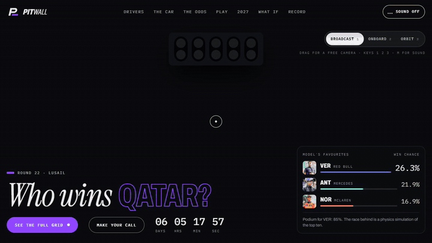
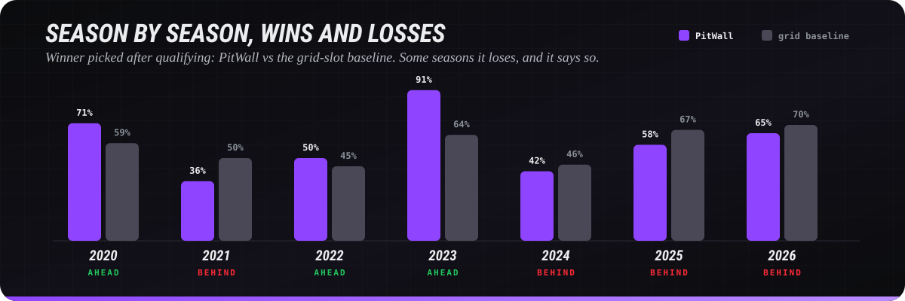
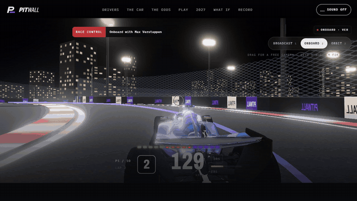
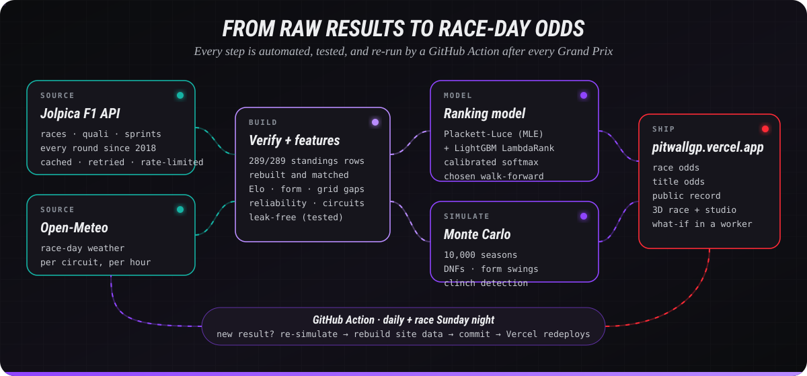
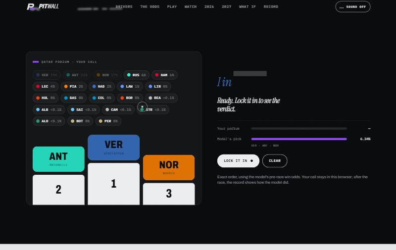

<div align="center">

<a href="https://pitwallgp.vercel.app"></a>


<br>

<a href="https://github.com/CodeWidKrish/PitWall/actions/workflows/ci.yml"></a>
<a href="https://github.com/CodeWidKrish/PitWall/actions/workflows/update.yml"></a>
<a href="https://github.com/CodeWidKrish/PitWall/releases"></a>
<a href="https://pitwallgp.vercel.app"></a>
<br>


<br>


<a href="LICENSE"></a>
<a href="https://github.com/CodeWidKrish/PitWall/stargazers"></a>
<a href="https://github.com/CodeWidKrish/PitWall/commits/main"></a>

<br><br>

**[🏁 Live site](https://pitwallgp.vercel.app)** &nbsp;•&nbsp;
**[🎬 Demo](#-lights-out)** &nbsp;•&nbsp;
**[📊 Track record](#-track-record)** &nbsp;•&nbsp;
**[🧩 Features](#-whats-on-the-site)** &nbsp;•&nbsp;
**[🧠 How it works](#-how-it-works)** &nbsp;•&nbsp;
**[🏎 Race physics](#-the-race-on-the-homepage)** &nbsp;•&nbsp;
**[🚀 Run it](#-run-it-yourself)** &nbsp;•&nbsp;
**[📜 Credits](#-credits)**

</div>

<br>

> [!NOTE]
> **Most F1 predictions are opinions, betting odds, or models you only hear about when they were right.** PitWall commits to a probability for every driver **before** each race, simulates both championships **10,000 times**, and then publishes its **whole record, misses included**, next to simple baselines. A GitHub Action updates everything by itself after every Grand Prix.

## 🎬 Lights out

<div align="center">
<a href="https://pitwallgp.vercel.app"></a>

<sub>The homepage, recorded from the live site. The cars are the model's top ten for the next race, driven by a physics model, not an animation path.</sub>
</div>

<br>


## 💡 Why PitWall?

<table>
<tr>
<th width="50%">😩 Typical F1 predictions</th>
<th width="50%">🏁 PitWall</th>
</tr>
<tr>
<td valign="top">

- A pundit's gut feeling, or a single "pick"
- Only the right calls get shared afterwards
- No baseline, so "70% accurate" means nothing
- Betting odds with the bookmaker's margin baked in
- A static table you read once and close

</td>
<td valign="top">

- A **calibrated probability** for every driver
- Published **before** the race, scored **after** it
- Compared with **grid-slot and Elo baselines**
- Title odds from **10,000 simulated seasons**
- A site you **play with**: race, car studio, podium game, what-if

</td>
</tr>
</table>


## 📊 Track record

<div align="center">

<br><br>

</div>


Every season from 2020 was predicted by a model trained **only on earlier seasons**, then scored against simple baselines. **151 races:**

| | 🏆 Picks the winner | 🥉 Winner in its top 3 | 🎯 Brier score (lower is better) |
|---|:---:|:---:|:---:|
| **PitWall, after qualifying** | **58.3%** | **89.4%** | **0.586** |
| Baseline: win rate by grid slot | 57.0% | 85.4% | 0.646 |
| **PitWall, before qualifying** | **47.7%** | **78.8%** | **0.693** |
| Baseline: Elo ratings alone | 47.0% | 68.9% | 0.741 |

> [!IMPORTANT]
> F1 has a lot of luck in it, so **no honest model picks the winner nine times in ten.** The hit rate beats the baselines only slightly. The real gain is the **Brier score**: when PitWall says 30%, that happens about 30% of the time. Full numbers in [the backtest report](model/reports/BACKTEST.md).


## 🗓 A race weekend on PitWall



## 🧩 What's on the site

<table>
<tr>
<td width="50%" valign="top">

### 🎥 Onboard, broadcast and orbit cameras
Switch cameras with <kbd>1</kbd> <kbd>2</kbd> <kbd>3</kbd>, or drag for a free camera. Live timing tower, speed, gear and DRS, race-control messages and team radio over real trackside sound.

</td>
<td width="50%" valign="top">



</td>
</tr>
<tr>
<td width="50%" valign="top">


</td>
<td width="50%" valign="top">

### 🏎 The car, up close
A detailed modern F1 car on a turntable. Paint it in **any team's livery** (a shader, not ten models), fit any of **five tyre compounds**, switch between **studio, night and sunset** light, and tap the pins to see what each part does.

</td>
</tr>
<tr>
<td width="50%" valign="top">

### 🎮 Beat the model
Tap three drivers onto the podium and lock it in. Exact **Plackett-Luce** maths tells you how likely the model thinks your order is, next to its own pick.

</td>
<td width="50%" valign="top">


</td>
</tr>
<tr>
<td width="50%" valign="top">


</td>
<td width="50%" valign="top">

### 🔮 Break the season
Give a team more pace over the winter, take a driver out from any round, add chaos or drop sprints, and **re-run 10,000 seasons in your browser** in a Web Worker.

</td>
</tr>
</table>

**Also on the site:** next-race odds for the whole grid with the inputs behind each number · 2027 title odds and a calendar with every circuit drawn · season standings and head-to-head · real race footage and engine recordings · a hit-or-miss record of every 2026 race · add the next race to your calendar.


## 🧠 How it works

<div align="center">

</div>

| Layer | What it does |
|---|---|
| 🗂 **Data** | Every race, qualifying session and sprint since 2018 from the Jolpica F1 API, with caching, retries and rate limiting. Race-day weather from Open-Meteo. All 289 standings rows from 2018 to 2026 are rebuilt from results and match the official tables; any unexplained difference fails the build. |
| 🧮 **Features** | Only what was known before each race: Elo from every head-to-head finish, recent form, grid and qualifying gaps to pole and teammate, retirement rates, team form, circuit history. A test changes one race's result and checks that the features for that race do not move. |
| 🤖 **Model** | A race is an ordering, so the core is a **Plackett-Luce** model fitted by maximum likelihood, blended after qualifying with a **LightGBM LambdaRank** model. A softmax temperature fitted on held-out seasons calibrates the probabilities. The model is chosen walk-forward, from earlier seasons only. |
| 🎲 **Championships** | The remaining races and sprints are played 10,000 times with Gumbel-max sampling, retirements drawn from team and driver reliability, season-long form swings, and clinch detection. |
| ⚙️ **Automation** | A GitHub Actions workflow checks for new results daily and on race Sundays. After a race it re-simulates, rebuilds the site data and commits it, which redeploys the site. At season end it rolls over to round 1 of the next season. |

## 🏎 The race on the homepage


| | |
|---|---|
| 🛞 **Lap physics** | A quasi-steady-state lap model: every corner's limit speed comes from tyre grip plus downforce, the straights from power against drag, braking from the grip limit. Forward and backward passes give the speed envelope, like real lap-time simulation. |
| 🛣 **Racing line** | Cars take outside, apex, outside, and move off line to defend or attack. |
| 🌪 **Dirty air, tow and DRS** | Following closely costs grip in corners; the tow (about +5 km/h) and DRS (about +10 km/h) help on the straights. |
| ⚔️ **Overtakes** | Side-by-side passes with a mirror check. A car only moves sideways into space that is actually free. |
| 🧱 **No contact** | Every car's footprint is a rotated rectangle in the drawn scene, and a separating-axis test keeps them apart, in corners and at the start. Whole races run headlessly in Node: **0 contact frames across six 5-minute races**, with lap times spread about 2.4%, like a real field. |
| 🎛 **Race craft** | Start reactions, driver form, tyre wear and the odd lock-up, so no two races look alike. |

## 🧰 Tech stack

<div align="center">

</div>

<div align="center">

| Website | Model | Infra |
|:---:|:---:|:---:|
| Next.js 16 · React 19 · TypeScript (strict) | Python 3.12 · uv | GitHub Actions (CI + post-race updates) |
| Tailwind 4 · three.js · custom shaders | pandas · NumPy · SciPy | Vercel (site) |
| Web Audio · Web Workers · Lenis | scikit-learn · LightGBM | Vercel Blob (3D model) |
| ESLint | ruff · mypy strict · pytest | Meshopt-compressed GLB pipeline |

</div>


## 🚀 Run it yourself

```bash
# the website
cd web
npm install
npm run dev            # http://localhost:3000
```

```bash
# the model (needs uv: https://docs.astral.sh/uv/)
cd model
uv sync
uv run pitwall data build          # download and verify the data
uv run pitwall model backtest      # season-by-season backtest
uv run pitwall model simulate      # championship odds
uv run pitwall site export         # the data the website shows
uv run pytest                      # 56 tests
```

> [!TIP]
> The 3D car is a licensed model and is **not in this repository**. To use your own, point `NEXT_PUBLIC_CAR_MODEL_URL` at a GLB. The cleaning pipeline is in [`tools/car-model`](tools/car-model).

## 🗂 Project structure

```
PitWall/
├── web/                      # Next.js site
│   └── src/
│       ├── app/              # routes: home, methodology, credits, privacy
│       ├── components/site/  # hero, odds, podium game, what-if, footer…
│       ├── components/three/ # race scene, race-sim (pure, tested), physics, car studio
│       └── lib/              # data, sound, simulator + web worker
├── model/                    # Python package `pitwall`
│   ├── src/pitwall/          # data, features, models, backtest, simulate, site export
│   ├── tests/                # pytest
│   └── reports/              # BACKTEST.md and title forecasts
├── tools/car-model/          # clean, recolour and compress the 3D car
├── docs/                     # case study, screenshots, README assets
└── .github/workflows/        # ci.yml, update.yml
```

## 📸 Screenshots

<table>
<tr>
<td></td>
<td></td>
</tr>
<tr>
<td></td>
<td></td>
</tr>
</table>

Want the full story, including the decisions I'd defend in a review? Read the **[case study](docs/CASE_STUDY.md)**.

## 📜 Credits

- **Results:** [Jolpica F1 API](https://github.com/jolpica/jolpica-f1). **Weather:** [Open-Meteo](https://open-meteo.com/).
- **Driver photos, footage and engine recordings:** Wikimedia Commons, each under its own free licence; authors and licences are on the site's [credits page](https://pitwallgp.vercel.app/credits).
- **3D car:** "2026 Mercedes W17" by Dave Love (Tyler_Dave) on Sketchfab, CC BY 4.0. Logos, number and tyre lettering removed and repainted per team; the model file is not in this repository.
- **Circuit layouts:** [f1-circuits](https://github.com/bacinger/f1-circuits) by Tomislav Bacinger, MIT.
- **Race highlights:** by FORMULA 1, linked on YouTube.

<sub>F1 and FORMULA 1 are trademarks of Formula One Licensing B.V. PitWall is not affiliated with Formula 1, the FIA or any team, uses no team or F1 logos, and is for analysis, not betting.</sub>

## ⭐ Star history

<div align="center">
<a href="https://star-history.com/#CodeWidKrish/PitWall&Date"></a>
</div>

## 👤 Author

<div align="center">

**Krish Hingu**<br>
Diploma in Computer Engineering · SBMPOC, Mumbai

<a href="https://github.com/CodeWidKrish"></a>
<a href="https://pitwallgp.vercel.app"></a>

If PitWall made race day more fun, please give it a ⭐

</div>


