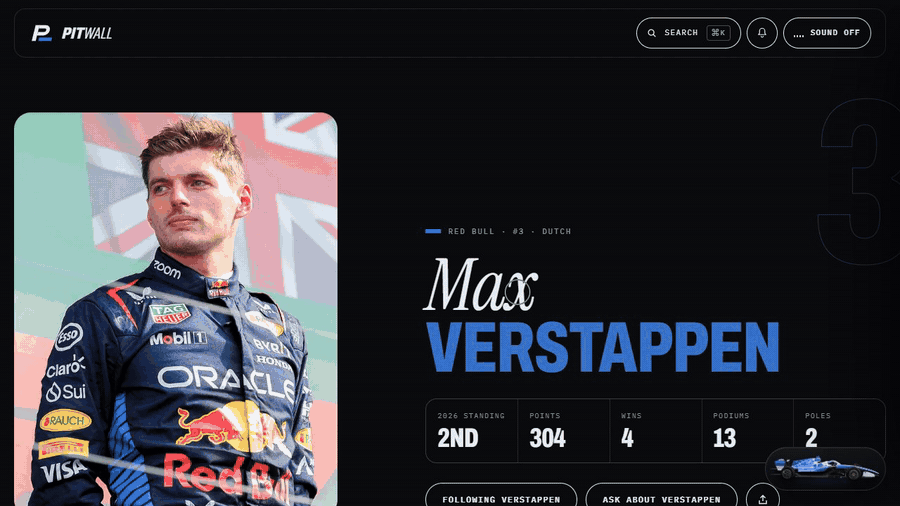
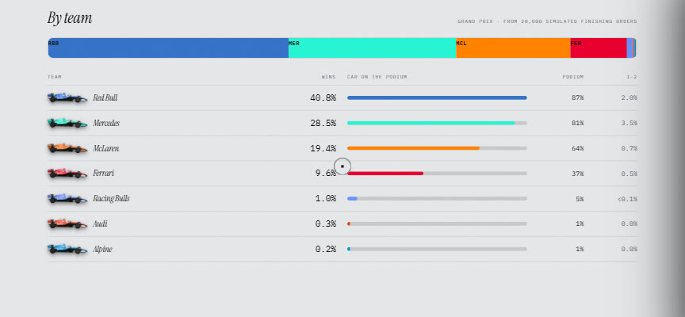
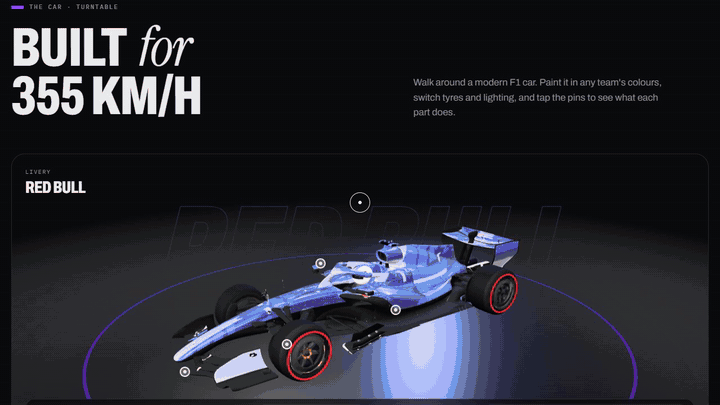
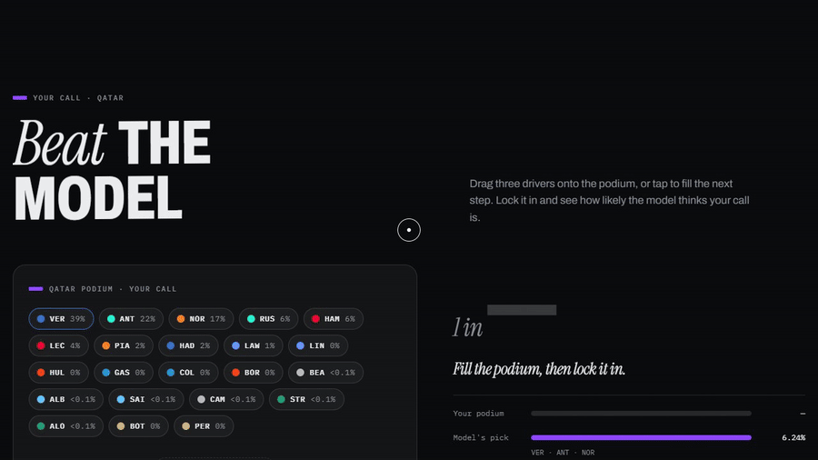
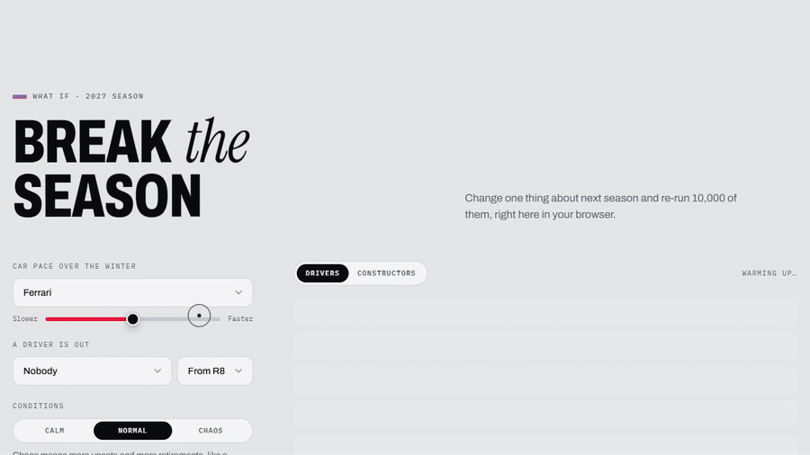
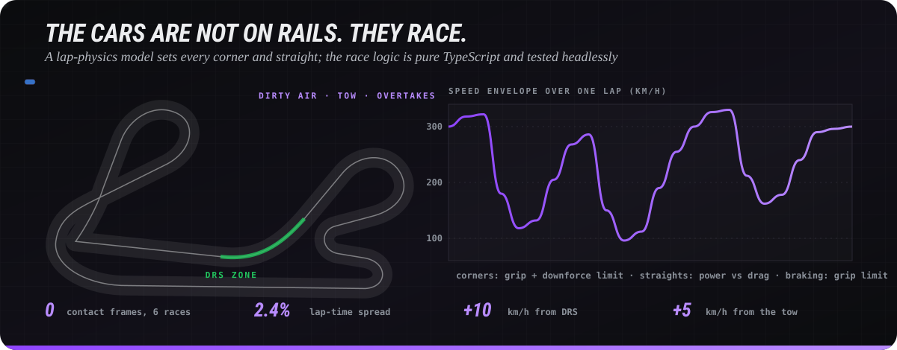
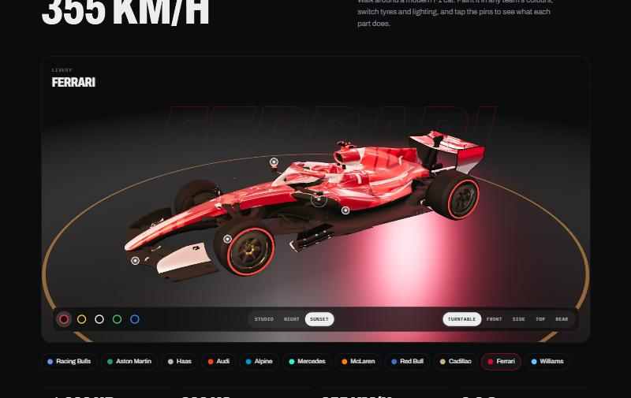

<div align="center">

<a href="https://pitwallgp.vercel.app"></a>


<br>

<a href="https://github.com/CodeWidKrish/PitWall/actions/workflows/ci.yml"></a>
<a href="https://github.com/CodeWidKrish/PitWall/actions/workflows/update.yml"></a>
<a href="https://github.com/CodeWidKrish/PitWall/releases"></a>
<a href="https://pitwallgp.vercel.app"></a>
<br>


<br>


<a href="LICENSE"></a>
<a href="https://github.com/CodeWidKrish/PitWall/stargazers"></a>
<a href="https://github.com/CodeWidKrish/PitWall/commits/main"></a>

<br><br>

**[🏁 Live site](https://pitwallgp.vercel.app)** &nbsp;•&nbsp;
**[🎬 Demo](#-lights-out)** &nbsp;•&nbsp;
**[📊 Track record](#-track-record)** &nbsp;•&nbsp;
**[🌟 Features](#-features)** &nbsp;•&nbsp;
**[🧠 How it works](#-how-it-works)** &nbsp;•&nbsp;
**[🏎 Race physics](#-the-race-on-the-homepage)** &nbsp;•&nbsp;
**[🚀 Run it](#-run-it-yourself)** &nbsp;•&nbsp;
**[❓ FAQ](#-faq)** &nbsp;•&nbsp;
**[📜 Credits](#-credits)**

</div>

<br>

> [!NOTE]
> **Most F1 predictions are opinions, betting odds, or models you only hear about when they were right.** PitWall commits to a probability for every driver **before** each race, simulates both championships **10,000 times**, and then publishes its **whole record, misses included**, next to simple baselines. A GitHub Action updates everything by itself after every Grand Prix.

## 🎬 Lights out

<div align="center">
<a href="https://pitwallgp.vercel.app"></a>

<sub>The homepage, recorded from the live site. The cars are the model's top ten for the next race, driven by a physics model, not an animation path.</sub>
</div>

<br>


## 💡 Why PitWall?

<table>
<tr>
<th width="50%">😩 Typical F1 predictions</th>
<th width="50%">🏁 PitWall</th>
</tr>
<tr>
<td valign="top">

- A pundit's gut feeling, or a single "pick"
- Only the right calls get shared afterwards
- No baseline, so "70% accurate" means nothing
- Betting odds with the bookmaker's margin baked in
- A static table you read once and close

</td>
<td valign="top">

- A **calibrated probability** for every driver
- Published **before** the race, scored **after** it
- Compared with **grid-slot and Elo baselines**
- Title odds from **10,000 simulated seasons**
- A site you **play with**: race, car studio, podium game, what-if

</td>
</tr>
</table>

## 🌟 Features

| | Feature | Details |
|:-:|---|---|
| 🏆 | **Race odds** | Win and podium chance for every driver before every Grand Prix, re-run once the grid is known. |
| 🧾 | **The inputs behind each number** | Elo, recent form, qualifying gap, reliability and circuit history, shown next to every driver. |
| 🏁 | **Title forecast** | Both championships simulated 10,000 times, with retirements, form swings and clinch detection. |
| 📒 | **Public record** | Every 2026 race: what the model said, who won, hit or miss. Misses stay on the page. |
| 🏎 | **3D physics race** | The model's top ten race on a night circuit: braking zones, racing line, dirty air, tow, DRS, overtakes. |
| 🎥 | **Three cameras** | Broadcast director, onboard with speed, gear and DRS, and a free orbit camera. Keys <kbd>1</kbd> <kbd>2</kbd> <kbd>3</kbd>. |
| 📻 | **Real sound** | Freely licensed trackside and grid recordings, plus team radio and race-control messages. |
| 🎨 | **Car studio** | Any team's livery from one model via a shader, five tyre compounds, three lighting setups and part hotspots. |
| 🎮 | **Beat the model** | Pick a podium; exact Plackett-Luce maths says how likely the model thinks your order is. |
| 🔮 | **What-if simulator** | Change pace, drop a driver, add chaos: 10,000 seasons re-run in a Web Worker in about a second. |
| 🗺 | **Calendar with circuits** | Every 2027 round with its circuit drawn, and a one-click calendar export for the next race. |
| 🕒 | **Saturday update** | Odds re-run once the grid is set, with each driver's move shown. |
| 🏭 | **Constructor odds** | Win, podium and one-two chance per team, per race and per sprint. |
| 📒 | **Live record** | Every published call is logged before lights out and scored after, with a reliability chart. |
| 🔔 | **Race alerts** | Push notifications in race week and when the grid is set. |
| 💬 | **Ask the pit wall** | A chat that answers only from PitWall's data through read-only tools (odds, driver inputs, record, what-ifs), and shows what it used. |
| 🪪 | **Driver pages** | Every driver: odds with each input ranked against the field, points race by race, the model's record on them, and a share card. |
| 📸 | **Shareable calls** | Your podium call unfurls into a picture card; your calls are scored against the model's after every race. |
| 🌦 | **Race-day forecast** | Open-Meteo's forecast for lights out, next to the odds (context only). |
| 📝 | **Post-race explainer** | Each scored call opens to what the model said and what happened. |
| 🩺 | **Health and uptime** | `/api/health` and an hourly check that fails loudly if the site is down or a race goes unscored. |
| ⌨️ | **Command palette** | <kbd>Ctrl</kbd> <kbd>K</kbd>: jump anywhere, follow a driver, switch on alerts. |
| ⚙️ | **Updates itself** | A GitHub Action picks up qualifying, sprints and results, re-simulates, commits and redeploys. |

## 🆕 What's new in v1.4.0: real cars everywhere

- 🏎 **Every team's car, rendered from the site's own 3D model** in its livery colours (side on and three-quarter), as small transparent WebP images.
- 💬 The chat button is now the real car in the colours of the driver you follow: it drives in, rumbles and leaves speed lines on hover.
- 🏭 Team odds and the 2027 constructors list show each team's car driving in as the rows appear, and your team's car crosses the footer.

<div align="center">

<br>
<sub>Recorded on the site: the question is answered from Verstappen's real inputs, and the chip shows the data used.</sub>
</div>

<br>

<div align="center">

</div>

## 🆕 v1.3.0: the pit wall talks

- 💬 **Ask the pit wall:** questions answered by `gpt-oss-120b` on Groq, but only through read-only tools over PitWall's own data. It ranks a driver's inputs against the field, runs what-ifs on the simulator, says when it doesn't have something, and refuses betting advice.
- 🪪 **Driver pages** for the whole grid, each with a generated preview card for sharing.
- 📸 **Podium calls as pictures**, and a running score of your calls against the model's.
- 🌦 **Race-day forecast**, 📝 **post-race explainers**, and 🩺 **health checks** with hourly uptime monitoring.

## 🆕 v1.2.0: race weekend

- 🕒 **Saturday update.** Once qualifying is in, the odds are re-run with the grid and the gaps to pole and teammate, and each driver shows how far their chance moved.
- 🏁 **Sprint odds** on sprint weekends, with their own scale fitted on 30 past sprints, behind a Grand Prix / Sprint switch.
- 🏭 **Constructor odds:** each team's chance to win, to get a car on the podium and to finish one-two, from 20,000 simulated finishing orders.
- 📒 **Live record:** every forecast is written to [`ledger.json`](web/src/data/ledger.json) before lights out and scored after the race, with a live reliability chart. Its git history shows nothing is rewritten.
- 🔔 **Race alerts:** browser push notifications in race week and when the grid is set. No account; the subscription is kept in a private store and deleted when you switch off.
- ⌨️ **Command palette:** <kbd>Ctrl</kbd> <kbd>K</kbd> to jump to any section, follow any driver or switch on alerts.

## 🆕 v1.1.0: clean lines

- 🛞 **Cars face where they drive.** They used to point along the centre of the track while crossing it for the racing line, so they looked as if they were sliding. Now each car turns in, clips the apex and unwinds, at a steering-limited rate.
- 🛑 **Brake, turn, accelerate.** Speed comes from the lap model: from about **320 km/h** on the straights down to **98 km/h** in the hairpin, then back up on the exit.
- 🧱 **Corners too tight for two:** the car behind concedes early and lifts, instead of being pushed backwards.
- 📈 Fresh demo GIFs, and new animated architecture, track-record, season and physics graphics in this README.


## 📊 Track record

<div align="center">

<br><br>

</div>


Every season from 2020 was predicted by a model trained **only on earlier seasons**, then scored against simple baselines. **151 races:**

| | 🏆 Picks the winner | 🥉 Winner in its top 3 | 🎯 Brier score (lower is better) |
|---|:---:|:---:|:---:|
| **PitWall, after qualifying** | **58.3%** | **89.4%** | **0.586** |
| Baseline: win rate by grid slot | 57.0% | 85.4% | 0.646 |
| **PitWall, before qualifying** | **47.7%** | **78.8%** | **0.693** |
| Baseline: Elo ratings alone | 47.0% | 68.9% | 0.741 |

> [!IMPORTANT]
> F1 has a lot of luck in it, so **no honest model picks the winner nine times in ten.** The hit rate beats the baselines only slightly. The real gain is the **Brier score**: when PitWall says 30%, that happens about 30% of the time. Full numbers in [the backtest report](model/reports/BACKTEST.md).


## 🗓 A race weekend on PitWall


## 🧩 What's on the site

<table>
<tr>
<td width="50%" valign="top">

### 🎥 Onboard, broadcast and orbit cameras
Switch cameras with <kbd>1</kbd> <kbd>2</kbd> <kbd>3</kbd>, or drag for a free camera. Live timing tower, speed, gear and DRS, race-control messages and team radio over real trackside sound.

</td>
<td width="50%" valign="top">


</td>
</tr>
<tr>
<td width="50%" valign="top">



</td>
<td width="50%" valign="top">

### 🏎 The car, up close
A detailed modern F1 car on a turntable. Paint it in **any team's livery** (a shader, not ten models), fit any of **five tyre compounds**, switch between **studio, night and sunset** light, and tap the pins to see what each part does.

</td>
</tr>
<tr>
<td width="50%" valign="top">

### 🎮 Beat the model
Tap three drivers onto the podium and lock it in. Exact **Plackett-Luce** maths tells you how likely the model thinks your order is, next to its own pick.

</td>
<td width="50%" valign="top">



</td>
</tr>
<tr>
<td width="50%" valign="top">



</td>
<td width="50%" valign="top">

### 🔮 Break the season
Give a team more pace over the winter, take a driver out from any round, add chaos or drop sprints, and **re-run 10,000 seasons in your browser** in a Web Worker.

</td>
</tr>
</table>

**Also on the site:** next-race odds for the whole grid with the inputs behind each number · 2027 title odds and a calendar with every circuit drawn · season standings and head-to-head · real race footage and engine recordings · a hit-or-miss record of every 2026 race · add the next race to your calendar.


## 🧠 How it works

<div align="center">

</div>

| Layer | What it does |
|---|---|
| 🗂 **Data** | Every race, qualifying session and sprint since 2018 from the Jolpica F1 API, with caching, retries and rate limiting. Race-day weather from Open-Meteo. All 289 standings rows from 2018 to 2026 are rebuilt from results and match the official tables; any unexplained difference fails the build. |
| 🧮 **Features** | Only what was known before each race: Elo from every head-to-head finish, recent form, grid and qualifying gaps to pole and teammate, retirement rates, team form, circuit history. A test changes one race's result and checks that the features for that race do not move. |
| 🤖 **Model** | A race is an ordering, so the core is a **Plackett-Luce** model fitted by maximum likelihood, blended after qualifying with a **LightGBM LambdaRank** model. A softmax temperature fitted on held-out seasons calibrates the probabilities. The model is chosen walk-forward, from earlier seasons only. |
| 🎲 **Championships** | The remaining races and sprints are played 10,000 times with Gumbel-max sampling, retirements drawn from team and driver reliability, season-long form swings, and clinch detection. |
| ⚙️ **Automation** | A GitHub Actions workflow checks for new results daily and on race Sundays. After a race it re-simulates, rebuilds the site data and commits it, which redeploys the site. At season end it rolls over to round 1 of the next season. |

<details>
<summary><b>🔍 Under the hood: the pipeline commands</b></summary>
<br>

| Step | Command | What it does |
|---|---|---|
| 1. Data | `pitwall data build` | Downloads every race, qualifying session and sprint since 2018, plus weather, with caching and retries. Rebuilds the standings and fails on any unexplained difference. |
| 2. Backtest | `pitwall model backtest` | Walk-forward: each season is predicted by a model trained only on earlier seasons. Writes `model/reports/BACKTEST.md`. |
| 3. Simulate | `pitwall model simulate` | Plays the remaining season 10,000 times and writes title odds. |
| 4. Export | `pitwall site export` | Writes `web/src/data/site.json` and the simulator's inputs to `web/public/data/sim.json`. |
| 5. Ship | GitHub Action `update.yml` | Runs 1–4 when a new result appears, commits as the repo owner, and Vercel redeploys. |

</details>

## 🏎 The race on the homepage



| | |
|---|---|
| 🛞 **Lap physics** | A quasi-steady-state lap model: every corner's limit speed comes from tyre grip plus downforce, the straights from power against drag, braking from the grip limit. Forward and backward passes give the speed envelope, like real lap-time simulation. |
| 🛣 **Racing line** | Cars take outside, apex, outside, and move off line to defend or attack. |
| 🌪 **Dirty air, tow and DRS** | Following closely costs grip in corners; the tow (about +5 km/h) and DRS (about +10 km/h) help on the straights. |
| ⚔️ **Overtakes** | Side-by-side passes with a mirror check. A car only moves sideways into space that is actually free. |
| 🧱 **Clean racing** | Every car's footprint is a rotated rectangle in the drawn scene, pointing where the car is really going, and a separating-axis test keeps them apart. A car never steers into one alongside, concedes a corner too tight for two, and lifts rather than driving into the car ahead. Whole races run headlessly in Node: **3 frames of light contact in 108,000** across six 5-minute races, all in the lap-1 scramble. |
| 🎛 **Race craft** | Start reactions, driver form, tyre wear and the odd lock-up, so no two races look alike. |

## 🧰 Tech stack

<div align="center">

</div>

<div align="center">

| Website | Model | Infra |
|:---:|:---:|:---:|
| Next.js 16 · React 19 · TypeScript (strict) | Python 3.12 · uv | GitHub Actions (CI + post-race updates) |
| Tailwind 4 · three.js · custom shaders | pandas · NumPy · SciPy | Vercel (site) |
| Web Audio · Web Workers · Lenis | scikit-learn · LightGBM | Vercel Blob (3D model) |
| ESLint | ruff · mypy strict · pytest | Meshopt-compressed GLB pipeline |

</div>


## 🚀 Run it yourself

```bash
# the website
cd web
npm install
npm run dev            # http://localhost:3000
```

```bash
# the model (needs uv: https://docs.astral.sh/uv/)
cd model
uv sync
uv run pitwall data build          # download and verify the data
uv run pitwall model backtest      # season-by-season backtest
uv run pitwall model simulate      # championship odds
uv run pitwall site export         # the data the website shows
uv run pytest                      # 56 tests
```

> [!TIP]
> The 3D car is a licensed model and is **not in this repository**. To use your own, point `NEXT_PUBLIC_CAR_MODEL_URL` at a GLB. The cleaning pipeline is in [`tools/car-model`](tools/car-model).

## 🗂 Project structure

```
PitWall/
├── web/                      # Next.js site
│   └── src/
│       ├── app/              # routes: home, methodology, credits, privacy
│       ├── components/site/  # hero, odds, podium game, what-if, footer…
│       ├── components/three/ # race scene, race-sim (pure, tested), physics, car studio
│       └── lib/              # data, sound, simulator + web worker
├── model/                    # Python package `pitwall`
│   ├── src/pitwall/          # data, features, models, backtest, simulate, site export
│   ├── tests/                # pytest
│   └── reports/              # BACKTEST.md and title forecasts
├── tools/car-model/          # clean, recolour and compress the 3D car
├── docs/                     # case study, screenshots, README assets
└── .github/workflows/        # ci.yml, update.yml
```

## 📸 Screenshots

<table>
<tr>
<td></td>
<td></td>
</tr>
<tr>
<td></td>
<td></td>
</tr>
</table>

Want the full story, including the decisions I'd defend in a review? Read the **[case study](docs/CASE_STUDY.md)**.

## ❓ FAQ

<details>
<summary><b>Is this for betting?</b></summary>
<br>
No. PitWall is for analysis and fun. Its edge over a simple grid-position baseline is small, and bookmakers price in far more information.
</details>

<details>
<summary><b>Why only 58% winners after qualifying?</b></summary>
<br>
Because F1 is uncertain: the pole-sitter's win rate alone gets 57%. A model claiming 80–90% would be overfitted or peeking at the future. PitWall's gain is in calibration (Brier 0.586 against 0.646), and the per-season chart above shows the seasons where it lost.
</details>

<details>
<summary><b>How do you know the backtest is not leaking the future?</b></summary>
<br>
Features only use races before the one being predicted, and a test changes one race's result and checks that its own features do not move. The model kind for each season is picked from the two seasons before it.
</details>

<details>
<summary><b>Is the 3D race a replay of the real race?</b></summary>
<br>
No. It is a simulation of the model's top ten on a fictional night circuit, driven by a lap-physics model, so it looks and moves like a race without claiming to predict laps.
</details>

<details>
<summary><b>Where does the 3D car come from?</b></summary>
<br>
A CC BY 4.0 model, cleaned of every logo and number and repainted per team in a shader. It is served from Vercel Blob and is not in this repository.
</details>

## ⚠️ Known limits

- The model knows nothing about upgrades, penalties announced after qualifying, or weather changes during the race.
- Before qualifying it is only slightly better than an Elo baseline at picking the winner (47.7% against 47.0%).
- In 2021, 2024, 2025 and 2026 it picked fewer winners after qualifying than the grid baseline.
- The homepage race is a simulation for show: in rare lap-1 scrambles two cars can touch for a frame (3 frames in 108,000 in tests).
- On phones with Data Saver on, the 3D car is skipped to save data.

## 🗺 Roadmap

- [x] Race odds before and after qualifying, with a public record
- [x] 10,000-season title forecast and a what-if simulator
- [x] 3D physics race, car studio and real sound
- [x] Post-race automation with GitHub Actions
- [x] Odds re-run on Saturday once the grid is set
- [x] Sprint-race odds on the race page
- [x] Constructor odds per race
- [x] A live ledger that scores every published call through the rest of 2026 and all of 2027
- [x] Push notifications for the odds before each race
- [x] A grounded chat over PitWall's data
- [x] Driver pages and shareable podium cards
- [ ] Bookmaker odds next to the model's (needs a licensed odds feed)
- [ ] Free-practice long-run pace as an input
- [ ] Sprint qualifying as an input to the sprint odds
- [ ] Grid penalties applied to the Saturday re-run

## 📜 Credits

- **Results:** [Jolpica F1 API](https://github.com/jolpica/jolpica-f1). **Weather:** [Open-Meteo](https://open-meteo.com/).
- **Driver photos, footage and engine recordings:** Wikimedia Commons, each under its own free licence; authors and licences are on the site's [credits page](https://pitwallgp.vercel.app/credits).
- **3D car:** "2026 Mercedes W17" by Dave Love (Tyler_Dave) on Sketchfab, CC BY 4.0. Logos, number and tyre lettering removed and repainted per team; the model file is not in this repository. The team car images in `web/public/cars` are renders of it.
- **Circuit layouts:** [f1-circuits](https://github.com/bacinger/f1-circuits) by Tomislav Bacinger, MIT.
- **Race highlights:** by FORMULA 1, linked on YouTube.

<sub>F1 and FORMULA 1 are trademarks of Formula One Licensing B.V. PitWall is not affiliated with Formula 1, the FIA or any team, uses no team or F1 logos, and is for analysis, not betting.</sub>

## ⭐ Star history

<div align="center">
<a href="https://star-history.com/#CodeWidKrish/PitWall&Date"></a>
</div>

## 👤 Author

<div align="center">

**Krish Hingu**<br>
Diploma in Computer Engineering · SBMPOC, Mumbai

<a href="https://github.com/CodeWidKrish"></a>
<a href="https://pitwallgp.vercel.app"></a>

If PitWall made race day more fun, please give it a ⭐

</div>


