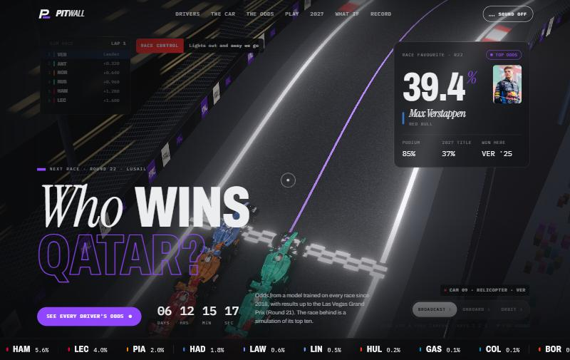
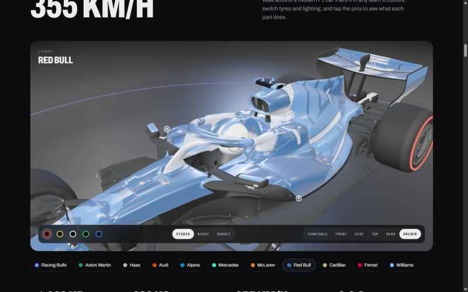

# PitWall

**Who wins the next Grand Prix, and who takes the title?**

PitWall is a machine-learning forecaster for Formula 1. It gives every driver a win and podium chance before each race, simulates both championships 10,000 times, and keeps a public record of every call so you can see how good it really is.

**Live: [pit-wall-mu-eight.vercel.app](https://pit-wall-mu-eight.vercel.app)** · [How the model works](https://pit-wall-mu-eight.vercel.app/methodology) · [Case study](docs/CASE_STUDY.md) · [Full backtest](model/reports/BACKTEST.md)



## Track record

Every season from 2020 was predicted by a model trained only on earlier seasons, then scored against a simple baseline. 151 races:

| | Picks the winner | Winner in its top 3 | Brier score (lower is better) |
|---|---|---|---|
| **After qualifying** | **58.3%** | **89.4%** | **0.586** |
| Baseline: win rate by grid slot | 57.0% | 85.4% | 0.646 |
| **Before qualifying** | **47.7%** | **78.8%** | **0.693** |
| Baseline: Elo ratings alone | 47.0% | 68.9% | 0.741 |

F1 has a lot of luck in it, so no honest model picks the winner nine times in ten. What PitWall aims for is calibration: when it says 30%, that should happen about 30% of the time.

## What is on the site

- **Next race odds.** Win and podium chances for the whole grid, with the inputs behind each number.
- **Beat the model.** Drag three drivers onto the podium and see the model's odds for that exact order next to its own pick.
- **2027 title forecast.** Both championships simulated 10,000 times from the announced calendar and the latest line-ups.
- **What-if simulator.** Give a team more pace, take a driver out, add chaos or drop sprints, and re-run 10,000 seasons in your browser (in a web worker).
- **Public record.** Every 2026 race: who won, what the model said, hit or miss.
- **A real race on the homepage.** A 3D night circuit where the model's top ten race on a physics model: tyre grip and downforce set the corner speeds, power and drag the straights; cars follow a racing line, lose grip in dirty air, use the tow and DRS, and overtake side by side. Broadcast, onboard and free cameras, live timing and team radio.
- **The car up close.** A detailed modern F1 car on a turntable: any team's livery, five tyre compounds, studio, night and sunset lighting, and hotspots that explain each part.
- **Real sound and footage.** Real F1 engine recordings and fan footage of real cars, all freely licensed.

| | |
|---|---|
|  |  |
|  | |

## How it works

| Layer | What it does |
|---|---|
| **Data** | Every race, qualifying session and sprint since 2018 from the Jolpica F1 API, plus race-day weather from Open-Meteo. Points are rebuilt from results and checked against the official standings after every round. |
| **Features** | What was known before each race: Elo ratings from head-to-head finishes, recent form, grid and qualifying gaps, retirements, team form, circuit history. Leak-free by construction, and tested. |
| **Model** | A Plackett-Luce ranking model, blended after qualifying with a LightGBM ranker. Probabilities are recalibrated on held-out seasons. The model kind is chosen walk-forward from earlier seasons only. |
| **Championships** | Monte Carlo: the remaining races and sprints are played 10,000 times with retirements, form swings for every team and driver, and clinch detection. |
| **Automation** | A GitHub Actions workflow checks for new results every day. After a race it re-runs the simulations, rebuilds the site's data and commits it, which redeploys the site. |
| **Web** | Next.js 16, React 19, TypeScript, Tailwind 4, three.js (race and studio scenes, race physics), Web Audio, Lenis. Deployed on Vercel; the 3D car is served from Vercel Blob. |

## Project structure

```
web/        Next.js website: sections, 3D scenes, race physics, simulator
model/      Python 3.12: data pipeline, features, models, backtest, simulation, site export
tools/      Pipeline that cleans and compresses the 3D car model
.github/    CI on every push, and the post-race update workflow
docs/       Case study and screenshots
```

## Run it

```bash
# website
cd web && npm install && npm run dev

# model (needs uv: https://docs.astral.sh/uv/)
cd model && uv sync
uv run pitwall data build          # download and check the data
uv run pitwall model backtest      # season-by-season backtest
uv run pitwall model simulate      # title odds
uv run pitwall site export         # the data the website shows
```

## Credits

- Results: [Jolpica F1 API](https://github.com/jolpica/jolpica-f1). Weather: [Open-Meteo](https://open-meteo.com/).
- Driver photos, footage and engine recordings: Wikimedia Commons, each under its own free licence; authors and licences are on the site's [credits page](https://pit-wall-mu-eight.vercel.app/credits).
- 3D car: "2026 Mercedes W17" by Dave Love (Tyler_Dave) on Sketchfab, CC BY 4.0. Logos, number and tyre lettering removed and repainted per team; the model file is not in this repository.
- Circuit layouts: [f1-circuits](https://github.com/bacinger/f1-circuits) by Tomislav Bacinger, MIT.
- Race highlights: by FORMULA 1, linked on YouTube.

F1 and FORMULA 1 are trademarks of Formula One Licensing B.V. PitWall is not affiliated with Formula 1, the FIA or any team, uses no team or F1 logos, and is for analysis, not betting.

## License

Code is released under the [MIT License](LICENSE). Third-party media keep their own licences, listed above.
